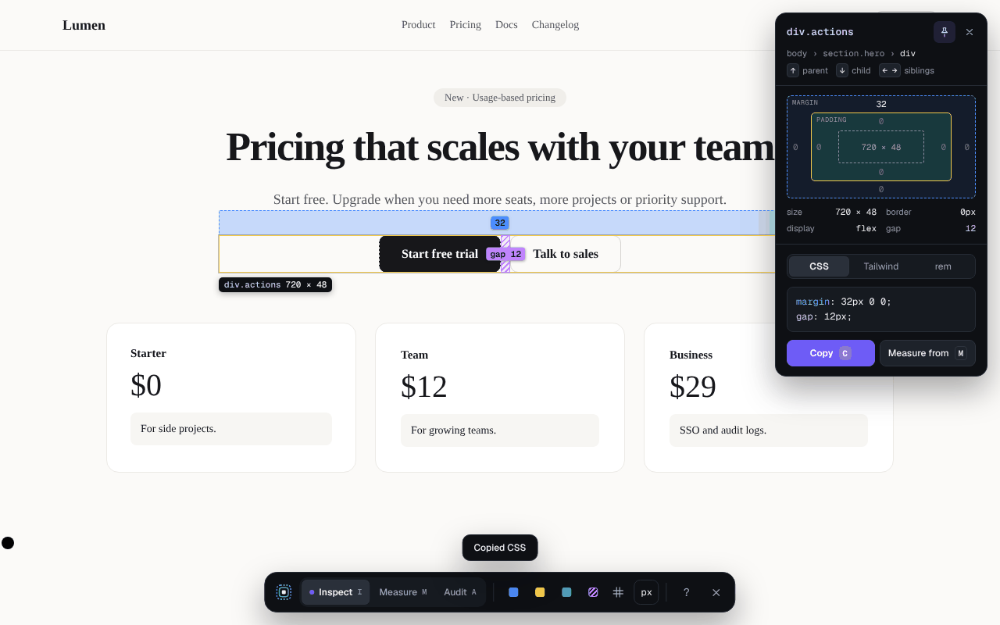
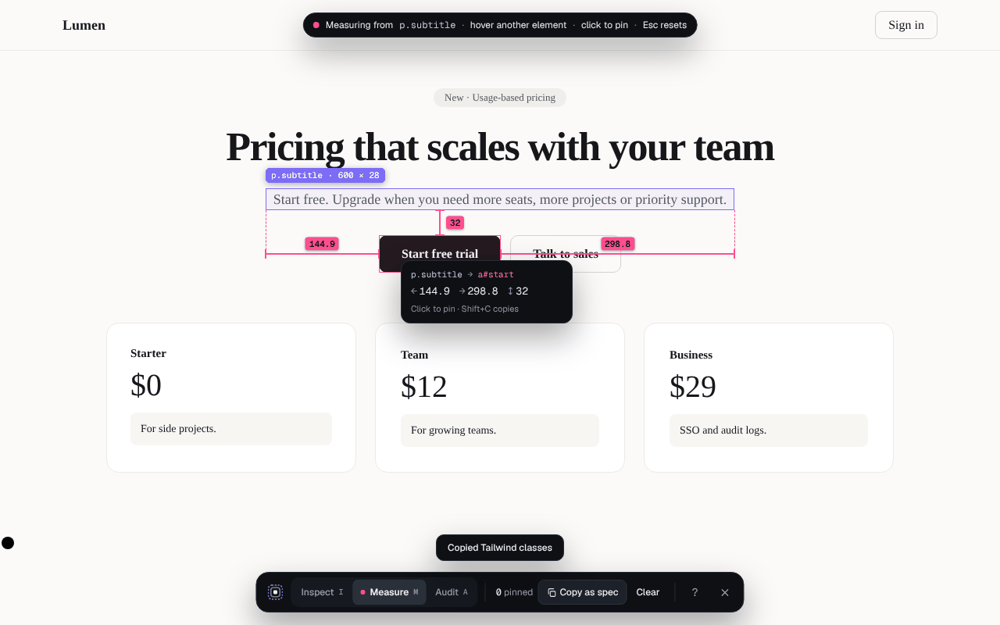
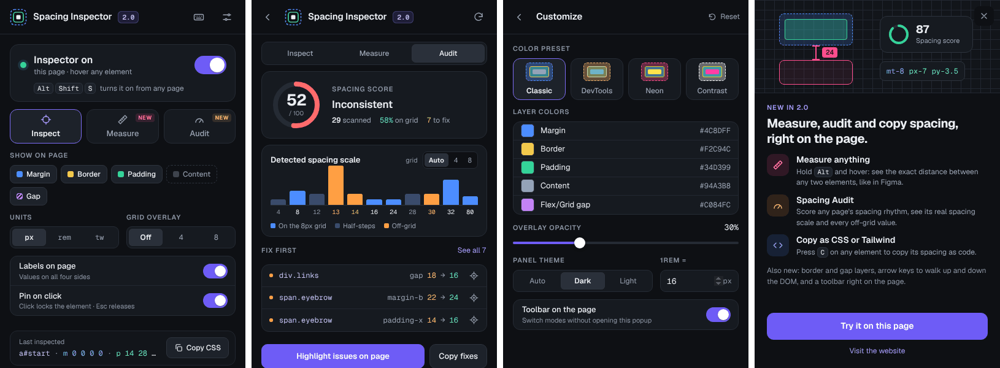

# Spacing Inspector

Chrome extension that shows the CSS box model of any element on any page: margin, border, padding, content and flex/grid gaps, with pixel values on every side.

[Chrome Web Store](https://chromewebstore.google.com/detail/spacing-inspector/ppnnhboeiefjhloholfbahddldadcjmk) · [Website](https://spacinginspector.netlify.app/)



## What's new in 2.0

**New features**

- **Measure.** Hold `Alt` while inspecting (or press `M`) to see the distance between any two elements. Click to pin measurements, then copy them all as a spec.
- **Spacing Audit.** Press `A` to scan the page. You get a spacing score out of 100, the page's real spacing scale (detected 4px or 8px grid), and every off-grid value with a suggested fix. Copy the fixes as CSS or export the report as JSON.
- **Copy as CSS, Tailwind or rem.** Press `C` on any element, for example `mt-8 py-3.5 px-7`.

**Redesigned experience**

- Full box model: margin, border, padding and content are drawn separately, plus a striped layer for flex/grid gaps.
- A toolbar on the page to switch modes and layers without opening the popup.
- An info card next to the element with a box-model diagram, size, display and code. Arrow keys walk to the parent, child and siblings.
- Grid overlay (4px or 8px), color presets (Classic, DevTools, Neon, Contrast), and a light or dark panel theme.
- A shortcut to turn it on from any page (`Alt+Shift+S` by default, changeable in `chrome://extensions/shortcuts`).
- On/off is now per tab and stays on while you browse in that tab. The toolbar icon shows an `ON` badge.

**Fixes from 1.0**

- Turning the inspector off now really removes its listeners (before, every re-enable stacked another copy).
- The popup toggle works on tabs that were open before installing.
- Padding no longer covers the content area, and borders are shown.
- No more crash when hovering SVG icons.
- Highlights follow scrolling and resizing.
- Custom colors are no longer overridden by the pulse animation.
- Settings from 1.x are migrated on update. Custom margin and padding colors and the labels setting are kept.

| Measure | Spacing Audit |
| --- | --- |
|  |  |



## Keyboard shortcuts (while the inspector is on)

| Keys | Action |
| --- | --- |
| `I` `M` `A` | Inspect, Measure, Audit |
| hold `Alt` | Measure from the hovered or pinned element |
| `P` or click | Pin or unpin the element |
| `↑` `↓` / `←` `→` | Parent, child / siblings (in Audit: previous and next issue) |
| `C` | Copy as CSS, Tailwind or rem (follows the Units setting) |
| `Shift+C` | Copy the current measurement |
| `G` / `U` | Cycle the grid overlay / units |
| `?` | Show shortcuts |
| `Esc` | Step back (unpin, clear), then turn off |

## Project layout

```
extension/            the unpacked extension (this folder is what gets zipped)
  manifest.json
  background.js       service worker: settings migration, per-tab state, shortcut, badge
  lib/core.js         pure logic shared by everything: units, Tailwind, measuring, audit scoring
  content/inspector.js  overlay, info card, toolbar, Measure and Audit (all inside a shadow root)
  popup/              popup UI
  fonts/              Geist and Geist Mono (SIL Open Font License)
tests/
  core.test.js        unit tests for lib/core.js
  e2e.js              loads the extension in Chromium, drives it on tests/fixtures, saves screenshots
scripts/build.sh      builds dist/spacing-inspector-<version>.zip
```

## Develop

1. Open `chrome://extensions`, turn on Developer mode, click **Load unpacked** and choose the `extension` folder.
2. Run the tests:

```sh
npm test            # unit tests (Node 18+)
npm install         # once, for the end-to-end test
npm run test:e2e    # loads the extension in Chromium and checks every mode
npm run build       # dist/spacing-inspector-2.0.0.zip, ready to upload
```

## Permissions

`activeTab`, `storage` and `scripting`, plus the content script on all sites that 1.0 already had. Going from 1.x to 2.0 adds no new permission warnings, so Chrome won't disable the extension for existing users when it updates.
